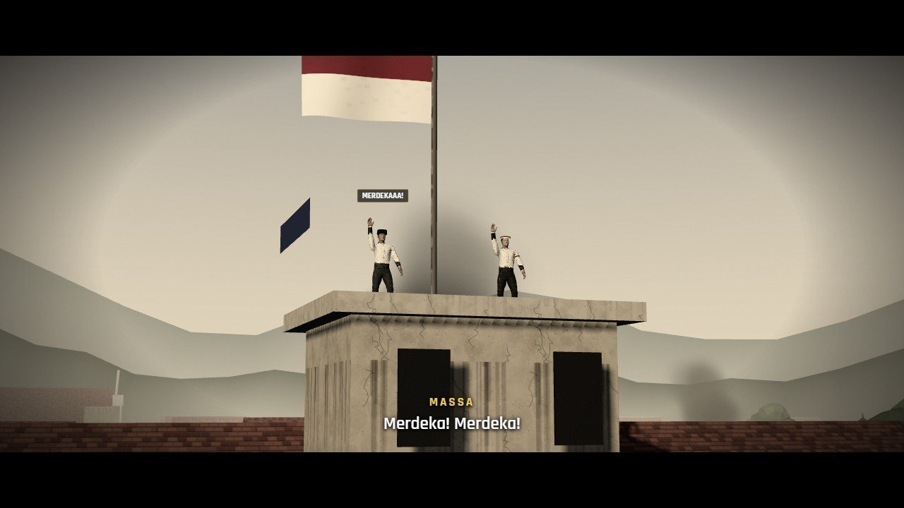
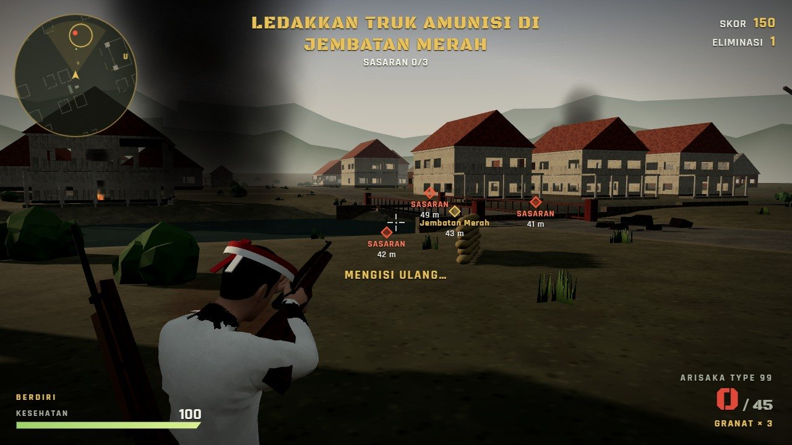
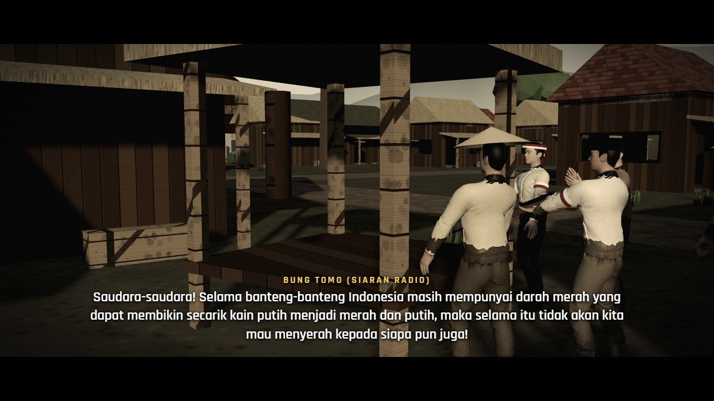
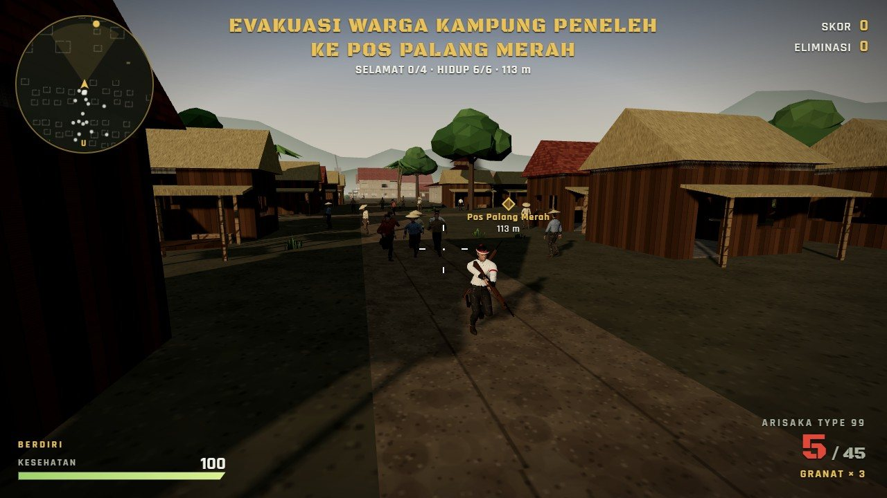
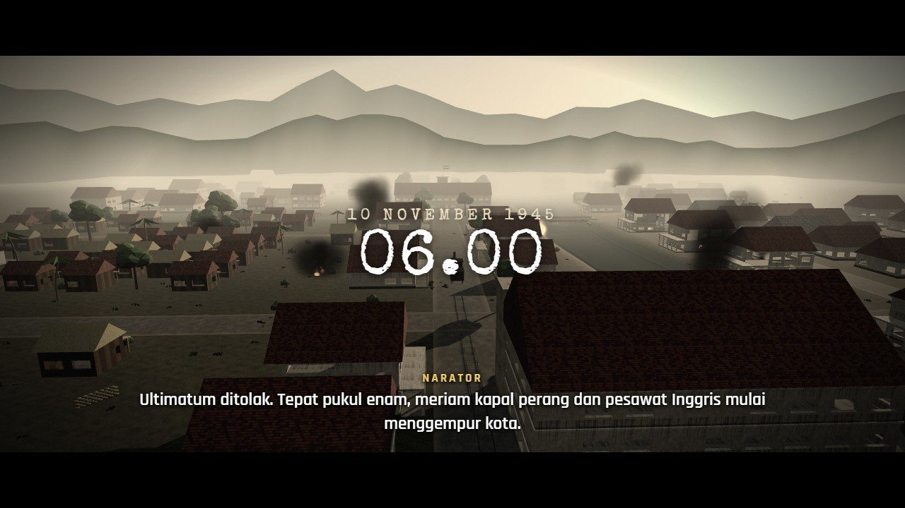
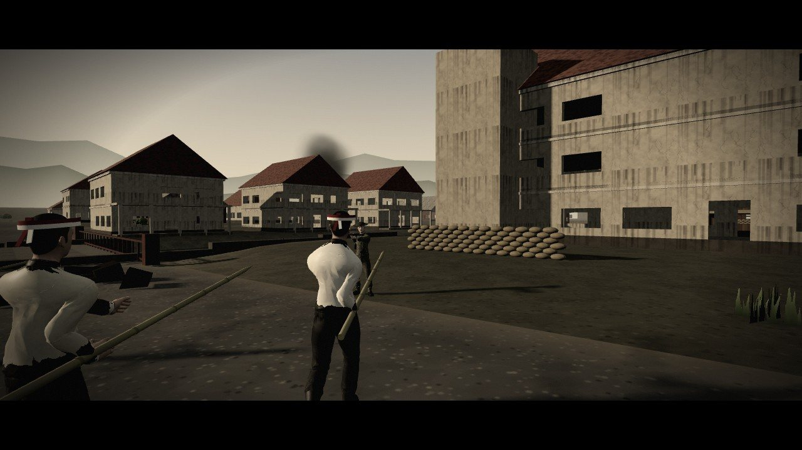
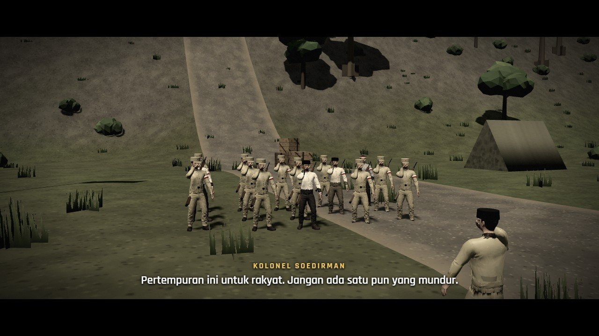
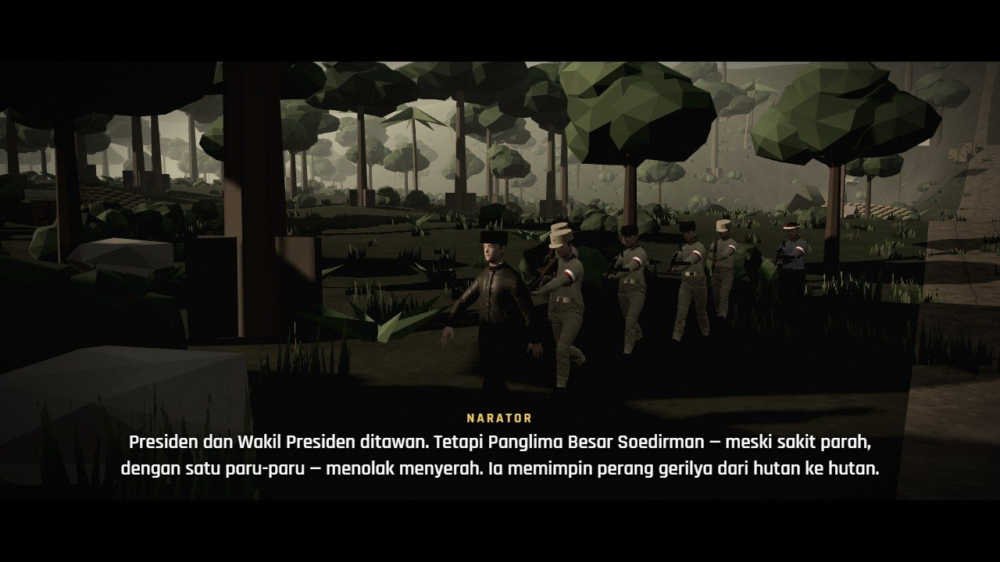

# Operasi Garuda — *Merdeka atau Mati* (Demo & Portofolio)



> 🎬 Trailer: [media/clips/trailer.mp4](media/clips/trailer.mp4)

**Merdeka atau Mati** adalah kampanye sinematik dalam game tembak orang ketiga **Operasi Garuda**. Latarnya Perang Kemerdekaan Indonesia 1945–1949. Game ini berjalan langsung di browser: adegan film dibuat di dalam mesin game, ada warga sipil yang hidup di peta, serta seragam dan senjata sesuai zamannya.

Repositori ini berisi **halaman portofolio** dan **demo yang bisa dimainkan**. Kode sumber lengkap game **tidak** disertakan. Demo adalah build yang sudah di-bundle & di-minify.

- 🎮 **Main demo:** buka situs → **▶ Mainkan Demo** → *KAMPANYE 1945* → *Bab 1*
- 📄 **Dokumen konsep lengkap:** [KONSEP.md](KONSEP.md)

---

## Cuplikan

| Film: Insiden Hotel Yamato | Gameplay: baku tembak di Jembatan Merah |
|---|---|
|  |  |
| **Film: siaran Bung Tomo** | **Gameplay: evakuasi warga** |
|  |  |
| **Film: gempuran 10 November** | **Tentara Sekutu berhelm Brodie** |
|  |  |
| **Film: pasukan TKR di Ambarawa** | **Film: Panglima Besar & pengawal** |
|  |  |

Video cuplikan (tanpa suara) ada di [`media/clips/`](media/clips/). Trailer: [`media/clips/trailer.mp4`](media/clips/trailer.mp4).

---

## Isi game

**Kampanye 3 bab**
1. **Arek-Arek Suroboyo** — Insiden Hotel Yamato, ultimatum & siaran Bung Tomo, gempuran 10 November, evakuasi warga, Gedung Internatio, Jembatan Merah. *(bisa dimainkan di demo)*
2. **Palagan Ambarawa** — serangan "Supit Urang" Kolonel Soedirman, stasiun kereta, bukit meriam, Benteng Willem I. *(versi lengkap)*
3. **Jalan Gerilya** — Agresi Militer II, mengawal rombongan Panglima Besar Soedirman menembus hutan. *(versi lengkap)*

**Fitur utama**
- Adegan film di dalam mesin game: kamera sinematik, kartu judul, subtitle, narasi suara, warna sepia / arsip hitam-putih.
- Warga sipil yang berjalan, mengobrol, panik saat ada tembakan, dan bisa dikawal.
- Faksi berkostum: pejuang, laskar bambu runcing, TKR, Sekutu (helm Brodie), NICA (helm M1), warga (peci, caping).
- Senjata 1945: Arisaka & Lee-Enfield (dengan animasi kokang), Sten, Colt, granat.
- Peta bersejarah: Surabaya 1945 dan Ambarawa 1945, ditambah 4 peta lain.
- Mode lain: Bertahan, Deathmatch, Tim Deathmatch, Battle Royale, multiplayer P2P lewat tautan, dan Editor Skenario (bisa membuat adegan film sendiri).

## Kontrol

| Tombol | Aksi |
|---|---|
| W A S D · Shift | Bergerak · lari |
| C · Z | Jongkok · tiarap |
| E | Berlindung di balik objek |
| Klik kiri · klik kanan | Tembak · bidik |
| R · G · V | Isi peluru · granat · lompat menghindar |
| F · Q | Orang pertama/ketiga · ganti bahu |
| 1 · 2 | Senapan · pistol |
| Tahan Spasi · Enter | Lewati film · adegan berikutnya |

Butuh komputer dengan Chrome/Edge terbaru, keyboard, dan mouse. Kalau terasa berat, pilih *Grafis: Rendah* di menu.

---

## Struktur repositori

```
index.html        halaman portofolio (pintu masuk)
KONSEP.md         dokumen konsep & desain lengkap
vercel.json       konfigurasi hosting Vercel
play/             demo yang bisa dimainkan (build ter-minify)
  index.html
  js/             kode game hasil bundle (bukan kode sumber)
  css/
  assets/         model karakter & senjata (.glb)
media/
  clips/          video cuplikan (.mp4) + trailer
  posters/        gambar sampul video
  shots/          screenshot
```

## Menjalankan secara lokal

Semua berkas statis, jadi cukup satu server statis apa saja:

```bash
npx serve .
# lalu buka http://localhost:3000
```

Jangan membuka `index.html` langsung dengan klik dua kali (`file://`): browser memblokir modul JavaScript & model 3D dari file lokal.

## Deploy ke Vercel

1. Masuk ke [vercel.com](https://vercel.com) → **Add New… → Project** → impor repositori ini.
2. **Framework Preset:** `Other`. **Build Command:** kosongkan. **Output Directory:** kosongkan (akar repositori).
3. Klik **Deploy**. Setiap `git push` ke cabang `main` akan otomatis diperbarui.

Atau lewat terminal: `npx vercel` lalu `npx vercel --prod`.

Multiplayer di Vercel memakai P2P (PeerJS) lewat tautan undangan, karena Vercel tidak menjalankan server WebSocket.

---

## Catatan sejarah

Tokoh utama dan rekan-rekannya fiktif. Peristiwa, tempat, dan tokoh sejarah diceritakan ringkas dan disederhanakan untuk kebutuhan permainan. Game ini dibuat untuk mengenang dan mengenalkan semangat perjuangan kemerdekaan, bukan sebagai sumber sejarah.

## Kredit

- Dibuat dengan [three.js](https://threejs.org) (lisensi MIT).
- Model karakter & animasi: Meshy & Mixamo.
- Font: Black Ops One, Rajdhani, Special Elite (Google Fonts).
- Semua suara disintesis di browser (Web Audio); narasi memakai Web Speech API.

© Mrx112 — demo & portofolio. Kode sumber lengkap tidak dipublikasikan.
